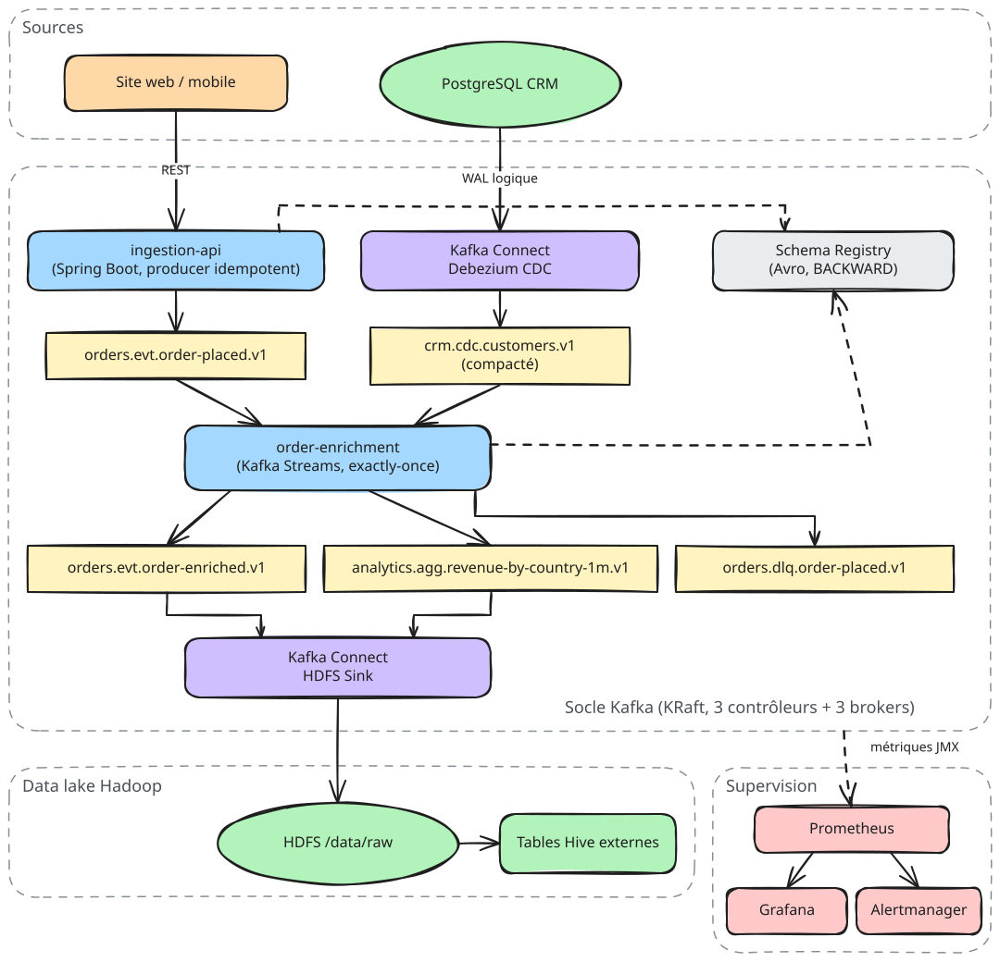

# Socle Data Kafka — plateforme d'événements temps réel

Socle de données d'entreprise construit sur **Apache Kafka 4 (KRaft)** : ingestion temps réel,
capture des changements des bases (CDC), traitement en flux, dépôt dans le **data lake Hadoop**,
gouvernance des données « as code », supervision **Prometheus / Grafana**, déploiement
**Ansible** (VM) et **Strimzi** (Kubernetes), et dossier d'exploitation complet.

> Projet de portfolio conçu pour démontrer un niveau architecte sur Kafka (préparation CCDAK + CCAAK).

## Le problème résolu

Une enseigne omnicanale (site web, application mobile, magasins) fait circuler ses données par
des **traitements batch nocturnes** et des **intégrations point à point** :

| Aujourd'hui | Conséquence |
| --- | --- |
| Export nocturne des bases vers Hadoop (Sqoop, scripts) | Les équipes métier voient les ventes à J+1 |
| Chaque application appelle directement les autres | N × M connexions, couplage fort, pannes en cascade |
| Aucun contrat de format | Un champ renommé casse les traitements en aval sans prévenir |
| Pas de vision d'exploitation unifiée | Incidents détectés par les utilisateurs |

Le socle remplace ce modèle par un **journal d'événements central** : chaque système publie ce qui
lui arrive une seule fois, chaque consommateur lit à son rythme, et l'historique reste rejouable.
Détails et objectifs chiffrés : [docs/architecture/00-probleme-et-objectifs.md](docs/architecture/00-probleme-et-objectifs.md).

## Architecture



Vue détaillée, flux, décisions : [docs/architecture/](docs/architecture/) et [docs/adr/](docs/adr/).

## Ce que contient le dépôt

| Dossier | Contenu |
| --- | --- |
| [`docs/architecture`](docs/architecture) | Problème, architecture cible, flux de données, conception des topics, sécurité, dimensionnement |
| [`docs/adr`](docs/adr) | Décisions d'architecture (KRaft, Avro, Strimzi + Ansible, HDFS, exactly-once) |
| [`docs/exploitation`](docs/exploitation) | **Dossier d'exploitation** : servitudes, arrêt/relance, supervision, runbooks, PRA, maintenance |
| [`platform/docker-compose`](platform/docker-compose) | Lab complet en une commande (Kafka, Connect, SR, Hadoop, PostgreSQL, supervision) |
| [`platform/ansible`](platform/ansible) | Déploiement sur VM : rôles, inventaires, playbooks d'arrêt, relance, rolling restart, contrôle |
| [`platform/strimzi`](platform/strimzi) | Déploiement Kubernetes : `Kafka`, `KafkaNodePool`, `KafkaTopic`, `KafkaUser`, `KafkaConnect`, alertes |
| [`monitoring`](monitoring) | Prometheus, règles d'alerte, Alertmanager, exporteurs JMX, tableaux de bord Grafana |
| [`governance`](governance) | Catalogue des topics et schémas Avro, source unique de vérité |
| [`connectors`](connectors) | Configurations Debezium (CDC) et HDFS Sink |
| [`hadoop`](hadoop) | Configuration HDFS du lab et DDL des tables Hive |
| [`services`](services) | Code Java 21 : `ingestion-api` (Spring Boot) et `order-enrichment` (Kafka Streams) |
| [`scripts/ops`](scripts/ops) | Arrêt, relance, contrôle de santé, contrôle des servitudes, export de configuration |
| [`tools`](tools) | Générateurs « as code » : topics, tableaux de bord, configuration JMX Strimzi |

## Démarrage rapide (lab Docker)

Prérequis : Docker 24+ avec Compose v2, 12 Go de RAM disponibles, Java 21 et Maven 3.9 pour les services.

```bash
make build        # compile les services Java et construit les images
make up           # démarre tout le socle (ordre maîtrisé, voir docs/exploitation)
make health       # contrôle de santé complet
make demo         # injecte des commandes de test et affiche le résultat enrichi
make down         # arrêt propre dans l'ordre inverse
```

| Interface | URL |
| --- | --- |
| Grafana (admin / admin) | http://localhost:3000 |
| Prometheus | http://localhost:9090 |
| Alertmanager | http://localhost:9093 |
| Kafka UI | http://localhost:8080 |
| Schema Registry | http://localhost:8081 |
| Kafka Connect REST | http://localhost:8083 |
| ingestion-api | http://localhost:8090/swagger-ui.html |
| HDFS NameNode | http://localhost:9870 |

## Garanties de conception (résumé)

| Exigence | Mécanisme |
| --- | --- |
| Aucune perte d'un événement acquitté | RF=3, `min.insync.replicas=2`, `acks=all`, rack awareness |
| Pas de doublon à l'ingestion | Producer idempotent, `eventId` unique |
| Traitement exactly-once | Kafka Streams `exactly_once_v2` |
| Évolution des formats sans casse | Schema Registry, compatibilité `BACKWARD_TRANSITIVE` |
| Messages invalides isolés | DLQ applicative + DLQ Kafka Connect |
| Ordre par commande et par client | Partitionnement par clé (`orderId`, `customerId`) |
| Détection des incidents < 5 min | 28 alertes Prometheus testées (promtool), chacune reliée à un runbook |

## Licence

Apache License 2.0. Apache Kafka est une marque de l'Apache Software Foundation.
Les composants Confluent (Schema Registry, connecteur HDFS) sont sous Confluent Community License.
