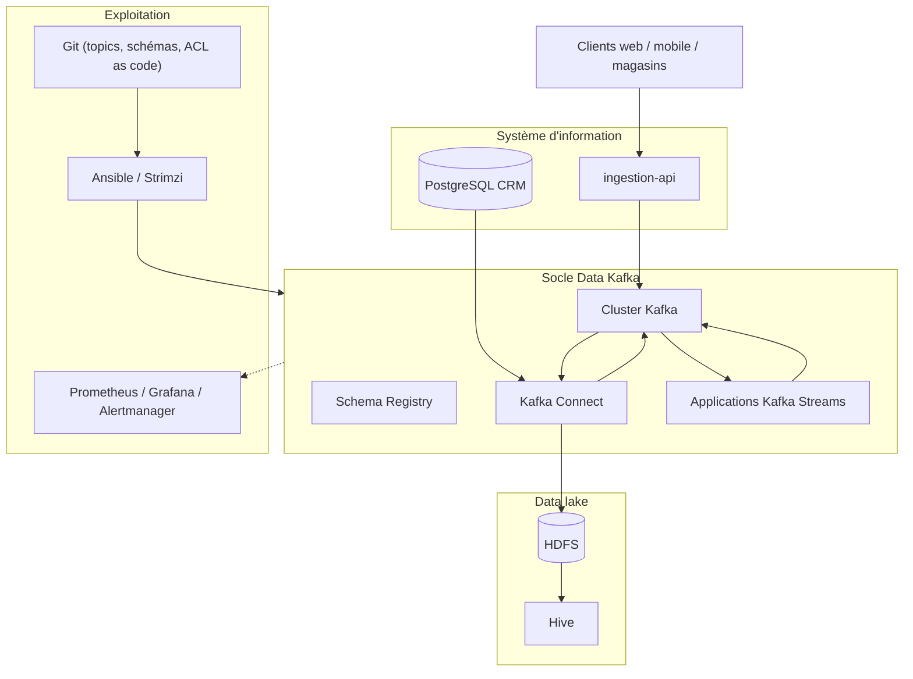
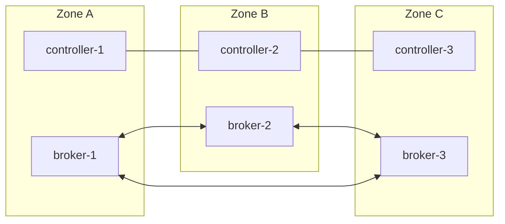

# 01 — Architecture cible

Le socle s'organise en quatre couches : **production** (sources), **transport** (Kafka et ses
composants), **traitement** (applications de flux), **restitution** (data lake et consommateurs).
Une cinquième couche transverse, **exploitation**, supervise et pilote l'ensemble.

## Vue de contexte

## Vue des conteneurs

| Composant | Rôle | Instances (prod) | Technologie |
| --- | --- | --- | --- |
| Contrôleurs KRaft | Quorum des métadonnées, élections de leaders | 3 (un par zone) | Apache Kafka 4.1 |
| Brokers | Stockage et service des partitions | 3 minimum, un par zone | Apache Kafka 4.1 |
| Schema Registry | Contrats Avro, contrôle de compatibilité | 2 (actif / secours) | Confluent Schema Registry 8.0 |
| Kafka Connect | CDC Debezium, HDFS Sink | 2 workers distribués | Kafka Connect + plugins |
| ingestion-api | Point d'entrée REST des commandes | 2+ (sans état) | Spring Boot 3, Java 21 |
| order-enrichment | Validation, jointure client, agrégats | 2+ (état local RocksDB) | Kafka Streams 4.1 |
| Prometheus, Alertmanager, Grafana | Supervision | 1 + 1 + 1 | Prometheus stack |
| kafka-exporter | Lag des consumer groups | 1 | danielqsj/kafka_exporter |
| HDFS / Hive | Data lake | Existant | Apache Hadoop 3 |

## Vue de déploiement

- `broker.rack` = zone : chaque partition a une réplica par zone. La perte d'une zone entière ne
  perd aucune donnée et laisse 2 réplicas sur 3, donc `min.insync.replicas=2` reste satisfait.
- Les contrôleurs sont séparés des brokers (pas de mode combiné en production) pour isoler le
  quorum des pics de charge.
- Deux cibles de déploiement, **même configuration logique** :
  - VM : `platform/ansible` (inventaire `prod`) ;
  - Kubernetes : `platform/strimzi` (opérateur Strimzi ≥ 0.49).

## Choix structurants

| Décision | Justification | ADR |
| --- | --- | --- |
| KRaft, sans ZooKeeper | Seul mode supporté depuis Kafka 4.0 ; une seule technologie à exploiter | [0001](../adr/0001-kraft-sans-zookeeper.md) |
| Avro + Schema Registry, `BACKWARD_TRANSITIVE` | Contrats vérifiés avant production, évolution sans casse | [0002](../adr/0002-avro-et-schema-registry.md) |
| Ansible maintenant, Strimzi en cible | Respecte l'existant, prépare Kubernetes | [0003](../adr/0003-ansible-et-strimzi.md) |
| Dépôt HDFS par Kafka Connect | Pas de code, reprise sur offset, partitionnement par date | [0004](../adr/0004-depot-hdfs-par-kafka-connect.md) |
| Exactly-once dans Kafka Streams, at-least-once ailleurs | Exactitude des agrégats, idempotence côté puits | [0005](../adr/0005-semantiques-de-livraison.md) |
| Topics, schémas et ACL « as code » | Revue par pull request, reproductible, auditable | [0006](../adr/0006-gouvernance-as-code.md) |
