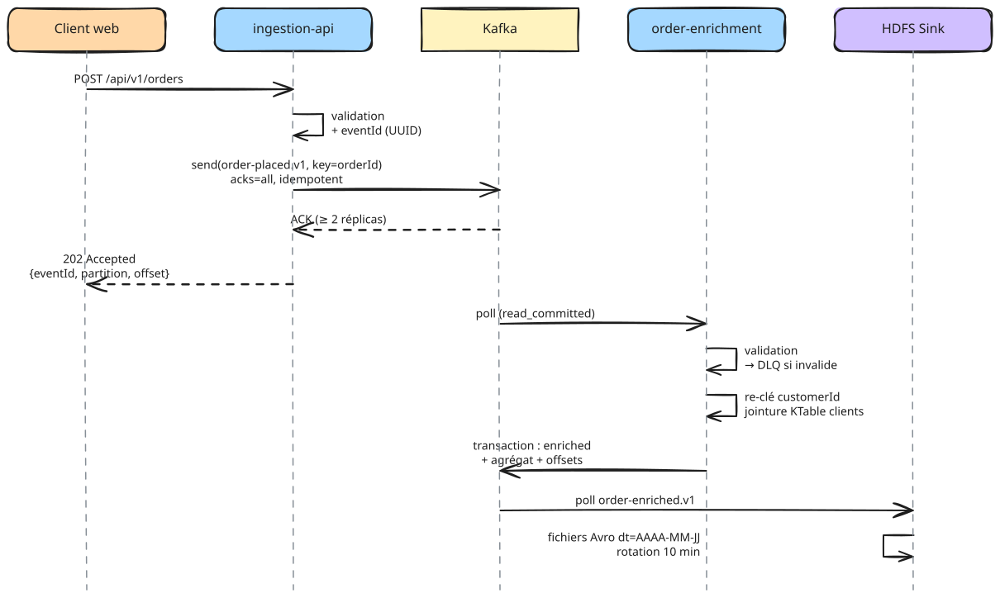
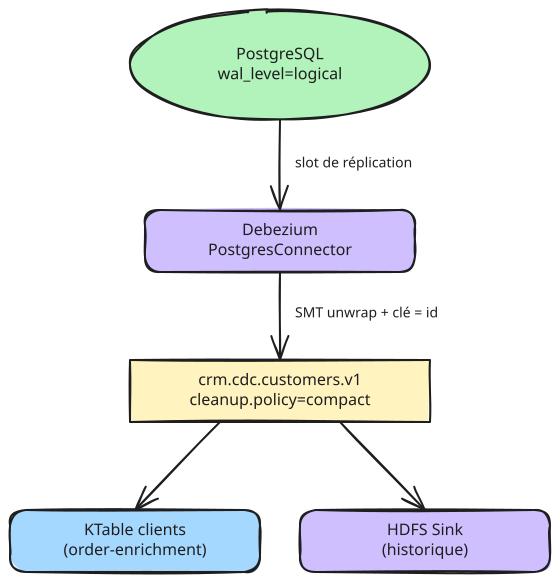

# Flux de données et garanties de bout en bout

## Flux 1 : commande passée (temps réel)

| Étape | Garantie | Mécanisme |
| --- | --- | --- |
| Client → API | Au moins une fois côté client (il réessaie sur erreur) | `eventId` fourni ou généré, idempotence métier en aval |
| API → Kafka | Pas de perte, pas de doublon dû aux retries | `acks=all`, `enable.idempotence=true`, `min.insync.replicas=2` |
| Kafka → Streams → Kafka | Exactly-once | `processing.guarantee=exactly_once_v2` |
| Kafka → HDFS | Exactly-once sur les fichiers | Le connecteur HDFS stocke ses offsets dans les noms de fichiers et reprend sans doublon |

## Flux 2 : clients CRM (CDC)

- Le topic est **compacté** : il contient au moins le dernier état de chaque client, ce qui permet à
  un nouveau consommateur de reconstruire la table complète sans relire la base.
- Une suppression en base produit un **tombstone** (valeur `null`), qui supprime le client de la KTable.
- Le slot de réplication PostgreSQL retient le WAL tant que Debezium ne l'a pas lu : la supervision
  surveille donc l'état du connecteur (alerte `KafkaConnectTaskFailed`), sinon le disque de la base
  se remplit. Voir [runbook RB-08](../exploitation/04-runbooks.md).

## Flux 3 : dépôt dans le data lake Hadoop

| Topic | Répertoire HDFS | Partitionnement | Table Hive |
| --- | --- | --- | --- |
| `orders.evt.order-enriched.v1` | `/data/raw/orders.evt.order-enriched.v1/dt=…` | Jour (heure de l'événement) | `raw.orders_enriched` |
| `analytics.agg.revenue-by-country-1m.v1` | `/data/raw/analytics.agg.revenue-by-country-1m.v1/dt=…` | Jour | `raw.revenue_by_country_1m` |
| `crm.cdc.customers.v1` | `/data/raw/crm.cdc.customers.v1/dt=…` | Jour | `raw.customers_history` |

Les tables Hive sont **externes** (DDL dans `hadoop/hive/`) : supprimer une table ne supprime pas
les fichiers. Un `MSCK REPAIR TABLE` quotidien (ou l'intégration Hive du connecteur) déclare les
nouvelles partitions.

Reprise de l'historique : les données Hadoop antérieures au socle restent dans leurs tables
existantes. Si un rejeu vers Kafka est nécessaire (par exemple pour initialiser un nouveau service),
un job Spark lit les tables Hive et produit vers un topic dédié `*.backfill.v1`, jamais vers le topic
temps réel, pour ne pas mélanger l'ordre des événements.

## Ordre des événements

| Besoin | Clé | Conséquence |
| --- | --- | --- |
| Tous les événements d'une commande dans l'ordre | `orderId` | Même partition pour une commande |
| Jointure avec le client | `customerId` (re-clé interne) | Topic de repartitionnement géré par Kafka Streams |
| État d'un client | `id` client | Compaction par client |

Il n'existe pas d'ordre global entre commandes de partitions différentes ; le socle n'en a pas besoin.

## Gestion des erreurs

| Erreur | Où | Traitement |
| --- | --- | --- |
| Requête REST invalide | ingestion-api | HTTP 400, rien n'est publié |
| Kafka indisponible | ingestion-api | Retries pendant `delivery.timeout.ms` (30 s), puis HTTP 503 |
| Commande incohérente (montant ≤ 0, sans article) | order-enrichment | Publiée sur `orders.dlq.order-placed.v1` avec l'en-tête `dlq.reason` |
| Client inconnu | order-enrichment | Enrichissement partiel (champs client à `null`), jamais bloquant |
| Message non désérialisable | HDFS Sink | `errors.tolerance=all`, envoi vers `platform.dlq.hdfs-sink.v1` |
