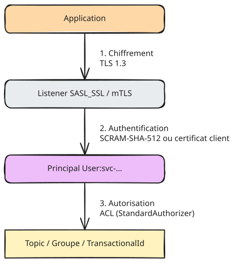

# Sécurité

Le lab Docker fonctionne en clair pour rester simple. La **production** (Ansible `prod` et Strimzi)
applique les règles ci-dessous.

## Modèle en trois couches

| Couche | VM (Ansible) | Kubernetes (Strimzi) |
| --- | --- | --- |
| Chiffrement | TLS, certificats de la PKI interne | TLS, certificats gérés par l'opérateur (clients CA / cluster CA) |
| Authentification clients | SASL SCRAM-SHA-512 | mTLS (`KafkaUser` type `tls`) |
| Authentification inter-brokers | mTLS | mTLS (automatique) |
| Autorisation | `StandardAuthorizer` + ACL | `authorization.type: simple` + ACL des `KafkaUser` |
| Super-utilisateurs | `User:admin`, `User:broker` | `CN=admin` uniquement |
| Refus par défaut | `allow.everyone.if.no.acl.found=false` | Idem |

## Matrice des droits (moindre privilège)

| Principal | Topic(s) | Opérations | Groupe | TransactionalId |
| --- | --- | --- | --- | --- |
| `svc-ingestion-api` | `orders.evt.order-placed.v1` | Write, Describe | — | — |
| `svc-order-enrichment` | lecture : `orders.evt.order-placed.v1`, `crm.cdc.customers.v1` ; écriture : `orders.evt.order-enriched.v1`, `analytics.agg.`, `orders.dlq.` ; préfixe `order-enrichment-` (topics internes) | Read, Write, Create, Describe | `order-enrichment` | préfixe `order-enrichment` |
| `svc-connect` | `_platform.connect.*`, `crm.cdc.`, lecture des topics déposés dans HDFS, `platform.dlq.` | Read, Write, Describe | `connect-socle`, `connect-` (préfixe) | — |
| `svc-monitoring` | `*` | Describe, DescribeConfigs | `*` Describe | — |

Traduction exacte : [`platform/strimzi/users/`](../../platform/strimzi/users).

À ne pas oublier :

- un consommateur a besoin de **Read sur le topic ET sur le groupe** ;
- une application Kafka Streams en exactly-once a besoin de **Write sur son TransactionalId** et de
  **Create** pour ses topics internes (`<application.id>-…-repartition`, `-changelog`) ;
- `IdempotentWrite` sur le cluster n'est plus nécessaire depuis Kafka 3.0 si l'utilisateur a Write sur le topic.

## Données personnelles

`crm.cdc.customers.v1` contient des données personnelles (classification dans le catalogue) :

- le connecteur Debezium **exclut** les colonnes inutiles (`column.exclude.list` : téléphone, date de naissance) ;
- l'e-mail est conservé dans Kafka (besoin CRM) mais **masqué** avant HDFS par un SMT `MaskField` ;
- le droit à l'effacement passe par un tombstone (suppression en base → `null` dans le topic compacté) ;
- les répertoires HDFS sont protégés par les ACL HDFS / Ranger existantes du data lake.

## Secrets

| Secret | VM | Kubernetes |
| --- | --- | --- |
| Mots de passe SCRAM | Ansible Vault (`group_vars/*/vault.yml`) | Secrets générés par le User Operator |
| Keystores / truststores | Ansible Vault + PKI | Secrets Strimzi |
| Mot de passe de la base CRM (Debezium) | Fichier `connect-secrets.properties` + `FileConfigProvider` | Secret monté + `KubernetesSecretConfigProvider` |

Aucun secret n'est versionné en clair ; la CI échoue si un motif de mot de passe est détecté.
