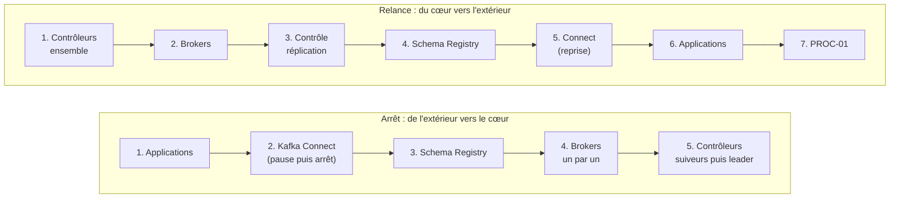

# 02 — Procédures d'arrêt et de relance

| Réf. | Procédure | Lab Docker | VM (Ansible) | Kubernetes (Strimzi) |
| --- | --- | --- | --- | --- |
| PROC-01 | Contrôle de santé | `make health` | `playbooks/healthcheck.yml` | Voir PROC-05 § contrôle |
| PROC-02 | Arrêt complet | `make stop` | `playbooks/stop.yml` | PROC-06 |
| PROC-03 | Relance complète | `make start` | `playbooks/start.yml` | PROC-06 |
| PROC-04 | Redémarrage roulant (sans coupure) | — | `playbooks/rolling-restart.yml` | PROC-05 |
| PROC-05 | Redémarrage roulant Kubernetes | — | — | annotation Strimzi |
| PROC-06 | Arrêt / relance Kubernetes | — | — | pause de réconciliation |
| PROC-07 | Export de configuration | `scripts/ops/export-config.sh` | `playbooks/export-config.yml` | idem (GitOps) |
| PROC-08 | Contrôle des servitudes | — | `scripts/ops/check-servitudes.sh` | idem |

## Principe : l'ordre compte



Pourquoi cet ordre :

| Règle | Raison |
| --- | --- |
| Applications arrêtées en premier | Un producteur qui écrit pendant l'arrêt des brokers reçoit des erreurs et réessaie ; on évite des alertes et des retries inutiles |
| Connecteurs mis **en pause** avant l'arrêt de Connect | La pause est mémorisée dans `_platform.connect.status` : à la relance, rien ne repart avant la fin des contrôles |
| Brokers **un par un** | Arrêt contrôlé : chaque broker transfère ses leaderships aux autres avant de s'arrêter, aucune partition ne devient hors ligne brutalement |
| Leader du quorum **en dernier** | Une seule élection au lieu de plusieurs |
| Contrôleurs relancés **ensemble** | Il faut une majorité (2 sur 3) pour élire un leader ; un contrôleur seul attend |
| Contrôle de la réplication **avant** les clients | On ne remet du trafic que sur un cluster complet (`under-replicated = 0`) |

## PROC-01 — Contrôle de santé

**Quand** : chaque matin, après toute intervention, à la clôture d'un incident.

| Point contrôlé | Attendu | Si KO |
| --- | --- | --- |
| Leader du quorum KRaft | Un `LeaderId` ≥ 0 | RB-02 |
| Brokers enregistrés | 3 / 3 | RB-01 |
| Partitions hors ligne | 0 | RB-03 |
| Partitions sous min ISR | 0 | RB-04 |
| Partitions sous-répliquées | 0 (toléré quelques minutes après un redémarrage) | RB-04 |
| Lag `order-enrichment`, `connect-hdfs-sink` | < 10 000 | RB-07 |
| Schema Registry | Répond | RB-10 |
| Connecteurs | Aucun `FAILED` | RB-08 |
| NTP, disque, certificats | Synchronisé, < 85 %, > 21 jours | RB-12, RB-06, RB-11 |

Commande manuelle équivalente (un broker) :

```bash
B=kbrk-a1.socle.interne:9092; C=/etc/kafka/admin.properties; K=/opt/kafka/bin
$K/kafka-metadata-quorum.sh --bootstrap-server $B --command-config $C describe --status
$K/kafka-topics.sh --bootstrap-server $B --command-config $C --describe --unavailable-partitions
$K/kafka-topics.sh --bootstrap-server $B --command-config $C --describe --under-min-isr-partitions
$K/kafka-topics.sh --bootstrap-server $B --command-config $C --describe --under-replicated-partitions
$K/kafka-consumer-groups.sh --bootstrap-server $B --command-config $C --describe --group order-enrichment
```

## PROC-02 — Arrêt complet

**Quand** : maintenance d'infrastructure lourde (déménagement, coupure électrique planifiée).
Pour une maintenance d'un seul nœud, préférer PROC-04 (pas de coupure).

Prérequis :

- [ ] Changement validé, fenêtre communiquée aux équipes productrices et consommatrices
- [ ] PROC-01 au vert (on n'arrête pas un cluster déjà dégradé sans analyse)
- [ ] PROC-07 exécutée (export de configuration du jour)
- [ ] Silence Alertmanager posé sur `cluster=socle-prod` pour la durée de la fenêtre

Exécution :

```bash
ansible-playbook -i inventories/prod/hosts.yml playbooks/stop.yml --ask-vault-pass
# Confirmation demandée : taper ARRET
```

| Étape | Action | Contrôle |
| --- | --- | --- |
| 1 | `systemctl stop ingestion-api order-enrichment` (SIGTERM, 40 s de grâce) | Plus de membre dans le groupe `order-enrichment` |
| 2 | `PUT /connectors/<nom>/pause` pour chaque connecteur, puis `systemctl stop kafka-connect` | `GET /connectors/<nom>/status` = `PAUSED` |
| 3 | `systemctl stop confluent-schema-registry` | Port 8081 fermé |
| 4 | Pour chaque broker, l'un après l'autre : `systemctl stop kafka` (arrêt contrôlé, jusqu'à 300 s) | Port 9092 fermé avant de passer au suivant |
| 5 | Contrôleurs suiveurs puis leader : `systemctl stop kafka` | Port 9093 fermé |

Durée typique : 5 à 10 minutes. Ne **jamais** utiliser `kill -9` : l'arrêt non contrôlé force la
récupération des logs au redémarrage (plusieurs minutes par broker) et des élections non propres.

## PROC-03 — Relance complète

```bash
ansible-playbook -i inventories/prod/hosts.yml playbooks/start.yml --ask-vault-pass
```

| Étape | Action | Contrôle bloquant |
| --- | --- | --- |
| 1 | Démarrer les 3 contrôleurs | `kafka-metadata-quorum.sh describe --status` affiche un `LeaderId` |
| 2 | Démarrer les brokers | Port 9092 ouvert sur chacun |
| 3 | Attendre la réplication | `--unavailable-partitions` vide **et** `--under-replicated-partitions` vide (jusqu'à 10 min après un arrêt brutal) |
| 4 | Démarrer le Schema Registry | `GET /subjects` répond 200 |
| 5 | Démarrer Kafka Connect puis `PUT /connectors/<nom>/resume` | Connecteurs `RUNNING` |
| 6 | Démarrer `order-enrichment` puis `ingestion-api` | Readiness de l'API à `UP` |
| 7 | PROC-01 complet, levée du silence Alertmanager | Tableau de bord « Vue d'ensemble » vert |

Après la relance, `order-enrichment` peut afficher un lag temporaire (rattrapage) : c'est normal tant
qu'il **décroît** (tableau de bord « Consommateurs et lag »).

## PROC-04 — Redémarrage roulant (VM)

**Quand** : application d'une configuration broker, correctif OS, montée de version, renouvellement
de certificat. **Sans interruption de service** si RF=3 et `min.insync.replicas=2`.

```bash
ansible-playbook playbooks/rolling-restart.yml                           # cluster complet
ansible-playbook playbooks/rolling-restart.yml --limit kbrk-b1.socle.interne
```

Déroulé automatique :

1. Pré-contrôle : aucune partition sous-répliquée ni hors ligne, sinon **arrêt** du playbook.
2. Contrôleurs suiveurs un par un, puis le leader (une seule réélection).
3. Brokers un par un ; après chaque broker, attente du retour à 0 partition sous-répliquée.
4. Élection du leader préféré pour rééquilibrer les leaders.

Pendant l'opération, les producteurs voient de brèves erreurs `NOT_LEADER_OR_FOLLOWER`, réessayées
automatiquement (aucune perte grâce à l'idempotence).

## PROC-05 — Redémarrage roulant (Kubernetes / Strimzi)

Strimzi redémarre lui-même les pods un par un, en vérifiant la disponibilité des partitions, à chaque
modification de la ressource `Kafka` ou d'un `KafkaNodePool`. Pour forcer un redémarrage roulant :

```bash
kubectl -n socle-data annotate strimzipodset socle-brokers strimzi.io/manual-rolling-update="true"
kubectl -n socle-data get pods -l strimzi.io/pool-name=brokers -w        # suivre le déroulement
# Un seul pod :
kubectl -n socle-data annotate pod socle-brokers-4 strimzi.io/manual-rolling-update="true"
```

Contrôle (équivalent PROC-01) :

```bash
kubectl -n socle-data get kafka socle -o jsonpath='{.status.conditions[?(@.type=="Ready")].status}'   # True
kubectl -n socle-data exec socle-brokers-3 -- bin/kafka-topics.sh --bootstrap-server localhost:9092 \
  --describe --under-replicated-partitions
kubectl -n socle-data get kafkaconnector     # READY = True
```

## PROC-06 — Arrêt et relance complets (Kubernetes)

Strimzi recrée les pods supprimés : un arrêt complet nécessite de **suspendre la réconciliation**.
Les volumes persistants sont conservés (`deleteClaim: false`).

Arrêt :

```bash
NS=socle-data
kubectl -n $NS scale deploy ingestion-api order-enrichment --replicas=0    # 1. applications
kubectl -n $NS annotate kafkaconnector --all strimzi.io/pause-reconciliation="true"
kubectl -n $NS patch kafkaconnector crm-customers-cdc hdfs-sink --type merge -p '{"spec":{"state":"paused"}}'
kubectl -n $NS patch kafkaconnect socle-connect --type merge -p '{"spec":{"replicas":0}}'   # 2. Connect
kubectl -n $NS scale deploy schema-registry --replicas=0                    # 3. Schema Registry
kubectl -n $NS annotate kafka socle strimzi.io/pause-reconciliation="true"  # 4. figer la réconciliation
kubectl -n strimzi scale deploy strimzi-cluster-operator --replicas=0      #    l'opérateur ne recrée plus les pods
for i in 5 4 3; do kubectl -n $NS delete pod socle-brokers-$i --wait; done # 5. brokers un par un
for i in 2 1 0; do kubectl -n $NS delete pod socle-controllers-$i --wait; done
```

Relance (ordre inverse) :

```bash
kubectl -n strimzi scale deploy strimzi-cluster-operator --replicas=1
kubectl -n $NS annotate kafka socle strimzi.io/pause-reconciliation-       # l'opérateur recrée contrôleurs puis brokers
kubectl -n $NS wait kafka/socle --for=condition=Ready --timeout=20m
kubectl -n $NS scale deploy schema-registry --replicas=2
kubectl -n $NS patch kafkaconnect socle-connect --type merge -p '{"spec":{"replicas":2}}'
kubectl -n $NS patch kafkaconnector crm-customers-cdc hdfs-sink --type merge -p '{"spec":{"state":"running"}}'
kubectl -n $NS annotate kafkaconnector --all strimzi.io/pause-reconciliation-
kubectl -n $NS scale deploy order-enrichment ingestion-api --replicas=2
```

À valider en recette pour la version de Strimzi installée (le comportement de la mise en pause de la
réconciliation et des `StrimziPodSet` peut évoluer entre versions).

## PROC-07 — Export de configuration

Sauvegarde **logique** (pas des données) : topics, configurations, ACL, consumer groups et leurs
offsets, schémas, connecteurs. Utile pour comparer avant/après une intervention et pour reconstruire
un cluster de secours.

```bash
ansible-playbook playbooks/export-config.yml          # -> platform/ansible/exports/socle-config-<date>.tar.gz
scripts/ops/export-config.sh                          # lab -> exports/<date>/
```

Planifié chaque nuit (cron ou ordonnanceur), conservé 30 jours (servitude S-13).

## Redémarrer un seul composant

| Composant | Commande | Précaution |
| --- | --- | --- |
| Un broker | `ansible-playbook playbooks/rolling-restart.yml --limit <hôte>` | Jamais deux brokers en même temps |
| Un worker Connect | `systemctl restart kafka-connect` | Les tâches migrent sur l'autre worker (rebalance de Connect) |
| Un connecteur | `curl -X POST "http://<connect>:8083/connectors/<nom>/restart?includeTasks=true&onlyFailed=true"` | Lire la trace avant (RB-08) |
| order-enrichment | `systemctl restart order-enrichment` | Reprise exactly-once depuis les offsets ; le state store local évite une restauration complète |
| ingestion-api | Une instance à la fois derrière le load balancer | Arrêt gracieux de 40 s : les requêtes en cours se terminent |
