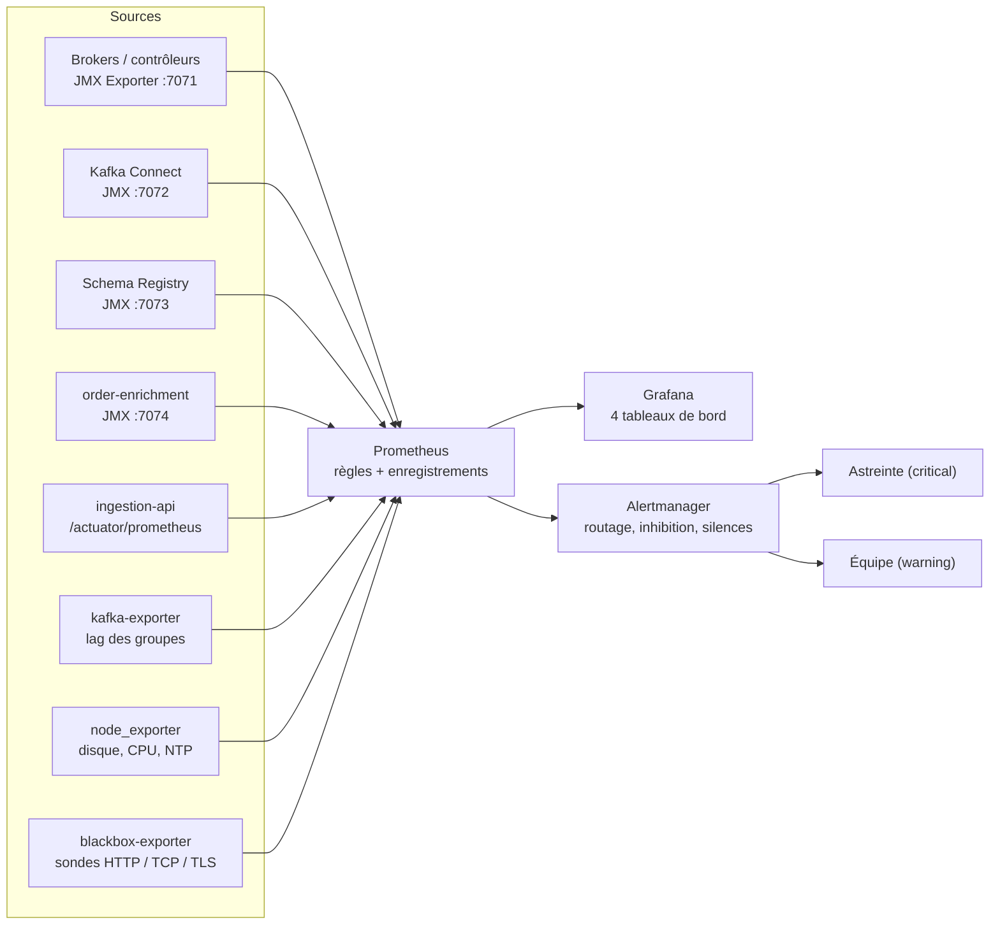

# 03 — Supervision et tableaux de bord

## Chaîne de supervision

Les mêmes fichiers servent partout :

| Élément | Source unique | Lab | VM | Kubernetes |
| --- | --- | --- | --- | --- |
| Règles JMX | `monitoring/jmx-exporter/*.yml` | monté dans les conteneurs | copié par `monitoring_agent` | ConfigMap générée |
| Alertes | `monitoring/prometheus/rules/kafka-alerts.yml` | monté | copié par `monitoring_stack` | `PrometheusRule` générée |
| Tableaux de bord | `tools/gen_dashboards.py` → `monitoring/grafana/dashboards/` | provisionnés | provisionnés | ConfigMap (sidecar Grafana) |

## Tableaux de bord Grafana

| Tableau de bord | Pour qui | Contenu |
| --- | --- | --- |
| **Socle Data — Vue d'ensemble** (accueil) | Astreinte, exploitation | Brokers et contrôleurs en ligne, contrôleur actif, partitions hors ligne / sous min ISR / sous-répliquées, disponibilité de l'ingestion (SLO), débit, lag, DLQ, sondes des servitudes |
| **Socle Data — Cluster Kafka** | Plateforme data | Réplication (URP, ISR, leaders), saturation des threads, latences p99 décomposées, débits, JVM, GC, disque, taille des topics |
| **Socle Data — Consommateurs et lag** | Plateforme, équipes applicatives | Lag par groupe et par partition, vitesse de consommation, membres, état et débit de Kafka Streams |
| **Socle Data — Kafka Connect et applications** | Plateforme, équipe commandes | État des connecteurs et tâches, DLQ, débits CDC / HDFS, HTTP de l'API, Schema Registry |

Les tableaux de bord sont en lecture seule dans Grafana (`allowUiUpdates: false`) : une modification se
fait dans `tools/gen_dashboards.py`, revue en pull request, puis `make generate`.

## Les indicateurs qui comptent

| Indicateur | Métrique | Normal | Seuil d'alerte |
| --- | --- | --- | --- |
| Partitions hors ligne | `kafka_controller_kafkacontroller_offlinepartitionscount` | 0 | > 0 (critique immédiat) |
| Partitions sous min ISR | `kafka_server_replicamanager_underminisrpartitioncount` | 0 | > 0 pendant 1 min (critique) |
| Partitions sous-répliquées | `kafka_server_replicamanager_underreplicatedpartitions` | 0 | > 0 pendant 5 min |
| Contrôleur actif | `sum(kafka_controller_kafkacontroller_activecontrollercount)` | 1 | ≠ 1 pendant 1 min |
| Inactivité threads I/O | `kafka_server_kafkarequesthandlerpool_requesthandleravgidlepercent` | > 0,5 | < 0,3 pendant 10 min |
| Latence Produce p99 | `kafka_network_requestmetrics_totaltimems{request="Produce",quantile="0.99"}` | < 50 ms | > 200 ms pendant 10 min |
| Lag d'un groupe | `kafka_consumergroup_lag` (somme) | < 1 000 | > 10 000 pendant 10 min, ou en hausse 15 min |
| Disque | `node_filesystem_avail_bytes` | < 60 % utilisé | 75 % (warning), 85 % (critique) |
| Connecteur / tâche | `kafka_connect_connector(_task)_status{status="failed"}` | absent | présent 1 min |
| Disponibilité ingestion | `socle:ingestion_availability:ratio_rate5m` | ≥ 99,9 % | erreurs 5xx > 5 % pendant 5 min |

## Catalogue des alertes

| Alerte | Sévérité | Runbook |
| --- | --- | --- |
| `KafkaBrokerDown` | critical | [RB-01](04-runbooks.md#rb-01--broker-indisponible) |
| `KafkaControllerDown` | warning | [RB-02](04-runbooks.md#rb-02--quorum-kraft) |
| `KafkaControllerQuorumAtRisk` | critical | [RB-02](04-runbooks.md#rb-02--quorum-kraft) |
| `KafkaNoActiveController` | critical | [RB-02](04-runbooks.md#rb-02--quorum-kraft) |
| `KafkaOfflinePartitions` | critical | [RB-03](04-runbooks.md#rb-03--partitions-hors-ligne) |
| `KafkaUnderMinIsrPartitions` | critical | [RB-04](04-runbooks.md#rb-04--réplication-dégradée) |
| `KafkaUnderReplicatedPartitions` | warning | [RB-04](04-runbooks.md#rb-04--réplication-dégradée) |
| `KafkaIsrFlapping` | warning | [RB-04](04-runbooks.md#rb-04--réplication-dégradée) |
| `KafkaRequestHandlerSaturated`, `KafkaNetworkProcessorSaturated`, `KafkaProduceLatencyHigh` | warning | [RB-05](04-runbooks.md#rb-05--saturation-dun-broker) |
| `DiskUsageHigh` / `DiskUsageCritical` | warning / critical | [RB-06](04-runbooks.md#rb-06--disque-plein) |
| `KafkaConsumerLagHigh`, `KafkaConsumerLagGrowing` | warning | [RB-07](04-runbooks.md#rb-07--lag-consommateur) |
| `KafkaCriticalConsumerGroupEmpty` | critical | [RB-07](04-runbooks.md#rb-07--lag-consommateur) |
| `KafkaConnectWorkerDown`, `KafkaConnectConnectorFailed`, `KafkaConnectTaskFailed` | critical | [RB-08](04-runbooks.md#rb-08--kafka-connect-en-échec) |
| `KafkaConnectDeadLetterQueue`, `OrderDlqReceivingMessages` | warning | [RB-09](04-runbooks.md#rb-09--messages-en-dlq) |
| `EndpointDown` | critical | [RB-10](04-runbooks.md#rb-10--point-dentrée-ou-servitude-indisponible) |
| `TlsCertificateExpiringSoon` | warning | [RB-11](04-runbooks.md#rb-11--certificats) |
| `ClockDriftHigh` | warning | [RB-12](04-runbooks.md#rb-12--dérive-horaire) |
| `KafkaJvmHeapHigh` | warning | [RB-13](04-runbooks.md#rb-13--mémoire-jvm) |
| `IngestionApiErrorRateHigh` | critical | [RB-14](04-runbooks.md#rb-14--erreurs-ingestion-api) |
| `OrderEnrichmentDown` | critical | [RB-15](04-runbooks.md#rb-15--order-enrichment-arrêté) |
| `Watchdog` | none | Toujours active : son **absence** chez l'outil d'astreinte signale une chaîne d'alerte cassée (servitude S-09) |

## Bonnes pratiques d'alerte appliquées

- **Une alerte = une action** : chaque alerte a un runbook ; une alerte sans action est supprimée.
- **Inhibition** : `KafkaBrokerDown` masque ses conséquences (sous-réplication, latence) pour ne pas noyer l'astreinte.
- **Durées `for`** : évitent les alertes sur des pics passagers (un rolling restart produit quelques
  minutes de sous-réplication normale : seuil à 5 min).
- **Tests unitaires** : `promtool test rules` vérifie dans la CI que les alertes critiques se déclenchent.
- **Silences** : toute maintenance planifiée pose un silence limité dans le temps
  (`amtool silence add cluster=socle-prod --duration=2h --comment="CHG-1234"`).
