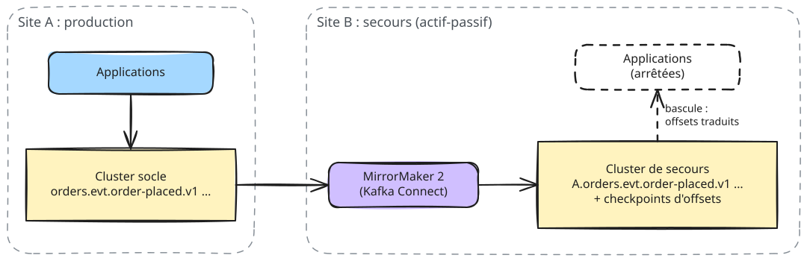

# 05 — Plan de reprise d'activité (PRA)

## Objectifs

| Scénario | Probabilité | RPO | RTO | Mécanisme |
| --- | --- | --- | --- | --- |
| Perte d'un broker | Fréquente | 0 | 0 (transparent) | RF=3, `min.insync.replicas=2`, élection automatique |
| Perte d'un contrôleur | Fréquente | 0 | 0 | Quorum 2 sur 3 |
| Perte d'une zone (AZ) | Rare | 0 | < 15 min (rattrapage) | Rack awareness : une réplica et un contrôleur par zone |
| Corruption logique (mauvais déploiement, données fausses) | Rare | Point dans le temps choisi | 1 à 4 h | Rétention + rejeu (reset d'offsets, réinitialisation Streams) |
| Suppression accidentelle d'un topic | Rare | Dépend de la copie | 1 à 4 h | Recréation depuis le catalogue + rechargement depuis HDFS ou le site de secours |
| Perte du site entier | Très rare | < 1 min | 4 h | Cluster de secours alimenté par MirrorMaker 2 |

## Architecture de secours (site B)

- MirrorMaker 2 tourne **sur le site de secours** (il lit à distance, écrit en local) : si le site A
  disparaît, rien n'est perdu côté B de ce qui était déjà répliqué.
- Topics préfixés par l'alias de la source (`A.`), schémas répliqués (topic `_schemas`), offsets des
  consumer groups traduits par `MirrorCheckpointConnector` (`sync.group.offsets.enabled=true`).
- Réplication **asynchrone** : RPO = retard de MirrorMaker 2 (métrique `replication-latency-ms`, alerte
  à 60 s).

## Procédure de bascule (site A perdu)

| # | Action | Responsable |
| --- | --- | --- |
| 1 | Déclarer le sinistre (décision de la cellule de crise) | Responsable de production |
| 2 | Vérifier le retard de réplication au moment de la perte (dernier `replication-latency-ms`) : c'est la perte de données | Plateforme |
| 3 | Arrêter MirrorMaker 2 (il n'a plus de source) | Plateforme |
| 4 | Pointer les applications sur le cluster B : `KAFKA_BOOTSTRAP_SERVERS`, `SCHEMA_REGISTRY_URL` | Applications |
| 5 | Les consommateurs lisent les topics `A.*` ; offsets déjà traduits (`sync.group.offsets.enabled`) | Applications |
| 6 | Les producteurs écrivent sur des topics non préfixés `orders.evt.*` créés depuis le catalogue (`apply-topics.yml`) | Plateforme |
| 7 | order-enrichment : nouvel `application.id` (`order-enrichment-b`), lecture de `A.orders...` puis `orders...` | Plateforme |
| 8 | Connecteur HDFS : redéployé sur B (le data lake reste la même cible) | Plateforme |
| 9 | PROC-01 sur B, communication aux métiers | Exploitation |

Retour sur A : reconstruire A, inverser MirrorMaker 2 (B → A), attendre le rattrapage, bascule
inverse planifiée hors heures de pointe.

## Ce qui n'est pas une sauvegarde

- La réplication interne protège du matériel, **pas** d'une erreur humaine (une suppression de topic
  est répliquée instantanément).
- MirrorMaker 2 réplique aussi les erreurs logiques, avec un léger retard.
- Les **vraies** protections contre l'erreur logique sont : la rétention (rejeu possible pendant 7 à 14 jours),
  le data lake HDFS (historique complet des flux enrichis), le catalogue Git (configuration) et PROC-07.

## Tests du PRA

| Test | Fréquence | Critère de succès |
| --- | --- | --- |
| Arrêt brutal d'un broker en production (heures creuses) | Trimestriel | Aucune erreur client, 0 partition hors ligne, retour ISR < 15 min |
| Arrêt d'une zone en recette | Semestriel | Aucune perte (contrôle `hadoop/hive/02-controles-qualite.sql`) |
| Bascule complète sur le site B en recette | Annuel | RTO ≤ 4 h mesuré, RPO conforme au retard MM2 |
| Rejeu d'une journée (reset d'offsets) en recette | Semestriel | Agrégats identiques au calcul initial |

Chaque test fait l'objet d'un compte rendu (durées mesurées, écarts, actions) archivé avec ce dossier.
