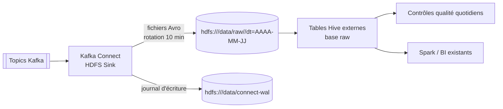

# Intégration Hadoop

Le socle **alimente** le data lake Hadoop existant ; il ne le remplace pas (ADR 0004).



| Élément | Lab | Production |
| --- | --- | --- |
| HDFS | 1 NameNode + 1 DataNode (`apache/hadoop`), sans sécurité | Cluster existant, HA NameNode, Kerberos |
| Authentification du connecteur | Aucune | `hdfs.authentication.kerberos=true`, principal `kafka-connect/_HOST@REALM`, keytab (servitude S-07) |
| Tables | DDL `hive/01-raw-tables.sql` | Idem, droits Ranger sur la base `raw` |
| Déclaration des partitions | `MSCK REPAIR TABLE` | Job quotidien ordonnancé, ou `hive.integration=true` dans le connecteur |

Fichiers :

- `config/hadoop.env` : configuration HDFS du lab ;
- `hive/01-raw-tables.sql` : tables externes ;
- `hive/02-controles-qualite.sql` : absence de doublons, rapprochement temps réel / data lake.

Vérifier le dépôt dans le lab :

```bash
docker compose -f platform/docker-compose/docker-compose.yml exec namenode hdfs dfs -ls -R /data/raw | head
```

Petits fichiers : une rotation de 10 minutes sur 12 partitions produit jusqu'à ~1 700 fichiers par
jour et par topic. Un job de compaction hebdomadaire (Spark ou `INSERT OVERWRITE` Hive) les regroupe
dans la zone `curated` ; il est hors périmètre du socle.
